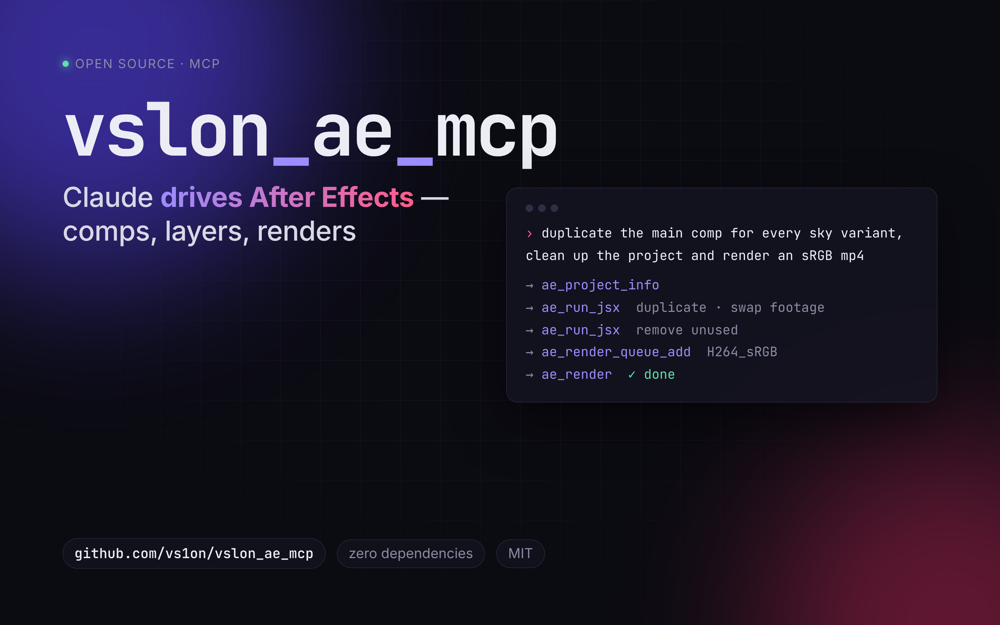
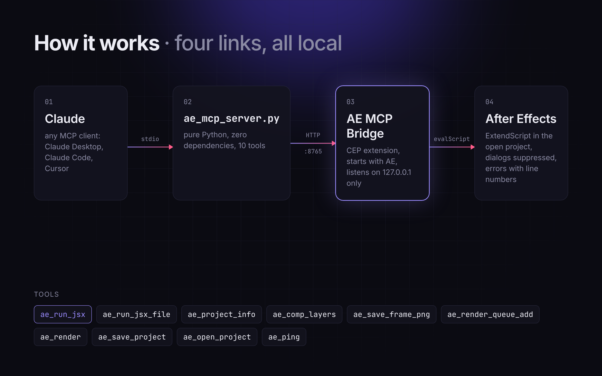

<div align="center">



# vslon_ae_mcp

**Control Adobe After Effects from Claude and other MCP clients.**

A small CEP bridge inside After Effects plus a zero-dependency MCP server: your assistant can read projects, edit comps, run ExtendScript and render. It does not drive the UI.

[](https://github.com/vs1on/vslon_ae_mcp/actions/workflows/ci.yml)


[](LICENSE)

[English](#features) · [Русский](#русский)

</div>

---

## Features

- **Full scripting access.** `ae_run_jsx` runs arbitrary ExtendScript in the open project, so anything the AE scripting DOM can do, the assistant can do.
- **Built-in shortcuts** for the common operations: project overview, layer and effect inspection, frame snapshots, render queue, save / save-as, open.
- **Safe by default.**
  - Dialogs are suppressed, so a script error never leaves AE frozen behind a modal window.
  - Errors come back with the ExtendScript line number.
  - The bridge listens on `127.0.0.1` only.
- **Zero dependencies.** There is no npm, no pip and no signed ZXP. Installing is copying one folder, and the server runs on any Python 3.9+.
- **Starts with AE.** A headless CEP extension brings the bridge up automatically. An optional panel shows its status and a request log.

## How it works



The MCP server wraps each request in a guarded ExtendScript function and posts it to the bridge. The bridge queues requests, because AE is single-threaded, evaluates them and returns JSON. See [docs/architecture.md](docs/architecture.md) for details.

## Requirements

| | |
|---|---|
| After Effects | 2020 (17.0) or newer. Developed and tested on **AE 2026 (26.x), Windows**. |
| OS | Windows. macOS is supported by the CEP layer; an install script is included but untested. |
| Python | 3.9+ (standard library only). |
| Client | Any MCP client that supports stdio servers: Claude Desktop, Claude Code, Cursor, … |

## Installation

### 1. Get the code

```bash
git clone https://github.com/vs1on/vslon_ae_mcp.git
```

### 2. Install the bridge into After Effects

**Windows**

```powershell
cd vslon_ae_mcp
powershell -ExecutionPolicy Bypass -File scripts\install.ps1
```

The script:
- copies `extension/com.vslon.aemcp` to `%APPDATA%\Adobe\CEP\extensions`;
- enables unsigned CEP extensions (`PlayerDebugMode=1` for CSXS 9–13, current user only);
- prints a ready-to-paste client config with absolute paths.

<details>
<summary>Manual install / macOS</summary>

1. Copy `extension/com.vslon.aemcp` to:
   - Windows: `%APPDATA%\Adobe\CEP\extensions\`
   - macOS: `~/Library/Application Support/Adobe/CEP/extensions/`
2. Enable unsigned extensions:
   - Windows: double-click `scripts/enable_cep_debug.reg`
   - macOS: run `defaults write com.adobe.CSXS.11 PlayerDebugMode 1`, and repeat for CSXS 9–13
3. On macOS, steps 1–2 are automated by `bash scripts/install_macos.sh`.

</details>

Restart After Effects. `Window > Extensions > AE MCP Bridge` should show **listening on 127.0.0.1:8765**. Seeing `already running` is also fine: the headless server started first.

### 3. Register the MCP server

Add this to your client config. For Claude Desktop: *Settings → Developer → Edit Config*.

```json
{
  "mcpServers": {
    "after-effects": {
      "command": "C:\\Python312\\python.exe",
      "args": ["C:\\path\\to\\vslon_ae_mcp\\server\\ae_mcp_server.py"]
    }
  }
}
```

For Claude Code:

```bash
claude mcp add after-effects -- python /path/to/vslon_ae_mcp/server/ae_mcp_server.py
```

Restart the client and ask: *"Ping After Effects."*

### 4. Verify from the terminal (optional)

```bash
python server/ae_mcp_server.py --check     # prints the AE version and the open project
```

## Tools

| Tool | What it does | Key arguments |
|---|---|---|
| `ae_ping` | Checks the bridge and AE; returns the AE version and open project. | |
| `ae_run_jsx` | Runs ExtendScript. The code is a function body: use `return`. | `code`, `timeout_s` |
| `ae_run_jsx_file` | Runs a `.jsx` file from disk. | `path`, `timeout_s` |
| `ae_project_info` | Lists all items (comps, footage, folders) and the render queue. | |
| `ae_comp_layers` | Lists the layers of a comp: sources, in/out, blend modes, mattes, effects, opacity. | `comp` |
| `ae_save_frame_png` | Renders one comp frame to PNG. | `comp`, `frame`, `path` |
| `ae_render_queue_add` | Queues a comp with an output-module template. | `comp`, `output_path`, `template`, `full_comp` |
| `ae_render` | Renders the queue, optionally only some items. Blocks until done. | `indices`, `timeout_s` |
| `ae_save_project` | Saves the project. With `path`, does Save As, e.g. for a new version. | `path` |
| `ae_open_project` | Opens an `.aep`. | `path` |

Example of a direct call:

```js
// ae_run_jsx → code
app.beginUndoGroup("Dim glows");
var c = app.project.activeItem, n = 0;
for (var i = 1; i <= c.numLayers; i++) {
  var L = c.layer(i);
  if (/glow/i.test(L.name)) { L.opacity.setValue(L.opacity.value * 0.4); n++; }
}
app.endUndoGroup();
return n + " layers updated";
```

More in [`examples/`](examples): ready-made `.jsx` snippets and [example prompts](examples/prompts.md).

## Configuration

| Variable | Default | Where |
|---|---|---|
| `AE_MCP_HOST` | `127.0.0.1` | MCP server |
| `AE_MCP_PORT` | `8765` | MCP server **and** After Effects. The bridge reads it at startup, so set it as a user environment variable before launching AE. |

## Security

`ae_run_jsx` executes arbitrary code with the permissions of After Effects. ExtendScript can read and write files and launch processes. The bridge only listens on the loopback interface. Do not forward or expose its port, and only connect clients you trust.

## Troubleshooting

See [docs/troubleshooting.md](docs/troubleshooting.md) for connection problems and the ExtendScript gotchas we hit in production:
- reserved words;
- linear PNGs in ACES projects;
- non-scriptable output color settings;
- re-rendering finished queue items;
- and more.

## Development

```
vslon_ae_mcp/
├── extension/com.vslon.aemcp/   CEP extension (manifest, bridge.js, panel, headless server)
├── server/ae_mcp_server.py      MCP stdio server
├── scripts/                     install / uninstall, registry file
├── examples/                    .jsx snippets, prompts, client config
├── docs/                        architecture, troubleshooting
└── tests/                       protocol tests against a fake bridge
```

The tests need neither After Effects nor any dependencies:

```bash
python -m unittest discover -s tests -v
```

To uninstall, run `scripts/uninstall.ps1` and remove the `after-effects` entry from your client config.

## License

[MIT](LICENSE) © vs1on

---

## Русский

**vslon_ae_mcp** даёт Claude и другим MCP-клиентам управлять After Effects. Он открывает и сохраняет проекты, разбирает композиции, выполняет любой ExtendScript и ставит рендер. Всё работает через скрипты, а не через клики по интерфейсу.

**Как устроено.** Внутри AE работает CEP-расширение *AE MCP Bridge* (локальный HTTP-сервер на `127.0.0.1:8765`, стартует вместе с AE). Снаружи работает MCP-сервер на чистом Python без зависимостей. Клиент вызывает инструмент, сервер оборачивает код в защищённую функцию: диалоги подавлены, ошибки возвращаются с номером строки. Мост выполняет код в AE.

**Установка (Windows):**

1. `git clone https://github.com/vs1on/vslon_ae_mcp.git`
2. `powershell -ExecutionPolicy Bypass -File scripts\install.ps1`. Скрипт скопирует расширение, разрешит неподписанные CEP-расширения и выведет готовый конфиг.
3. Вставьте конфиг в клиент. В Claude Desktop: *Settings → Developer → Edit Config*.
4. Перезапустите After Effects и клиент. В `Window > Extensions > AE MCP Bridge` должно быть *listening on 127.0.0.1:8765*.

**Инструменты:** `ae_ping`, `ae_run_jsx`, `ae_run_jsx_file`, `ae_project_info`, `ae_comp_layers`, `ae_save_frame_png`, `ae_render_queue_add`, `ae_render`, `ae_save_project`, `ae_open_project`.

**Важно:**
- В 32-bpc / ACES-проектах `ae_save_frame_png` отдаёт линейную (тёмную) картинку. Для корректного превью рендерите через очередь с шаблоном Output Module, где выставлен *Output Color Space: sRGB*. Цветовые настройки модуля вывода скриптом не меняются, поэтому шаблон создаётся один раз вручную.
- `ae_run_jsx` выполняет произвольный код с правами After Effects. Не открывайте порт моста наружу.

Подробнее: [docs/troubleshooting.md](docs/troubleshooting.md) · [docs/architecture.md](docs/architecture.md)
