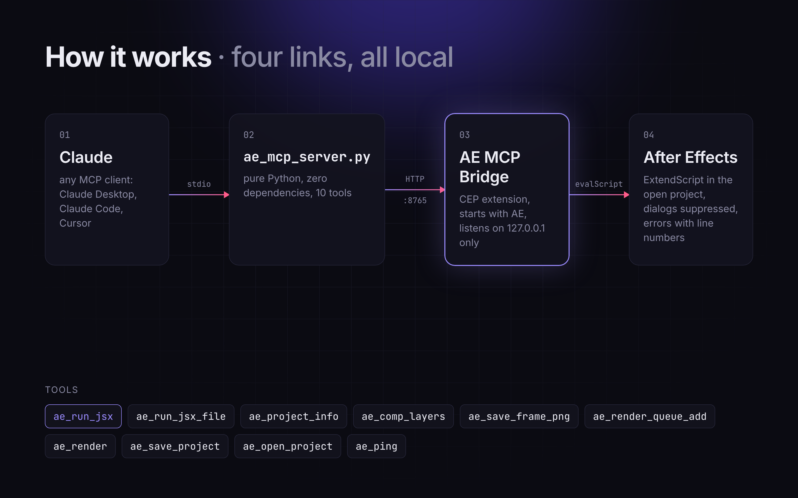
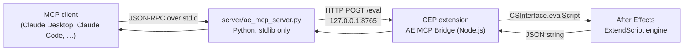

# Architecture





## Components

### `extension/com.vslon.aemcp` (inside After Effects)

A CEP extension with two entry points declared in `CSXS/manifest.xml`:

| Extension | Type | Purpose |
|---|---|---|
| `com.vslon.aemcp.server` | Custom, invisible | Starts on `ApplicationActivate`, so the bridge is up as soon as AE is. |
| `com.vslon.aemcp.panel` | Panel | `Window > Extensions > AE MCP Bridge`: shows status and a request log. Also starts the server if the headless one did not. |

Both load `js/bridge.js`, which runs a Node.js `http` server bound to `127.0.0.1` only:

- `GET /ping` returns `{ ok, app, port }`
- `POST /eval` with `{ "code": "<ExtendScript>" }` returns `{ ok, result }`, where `result` is the raw string returned by `evalScript`

Requests go through a promise queue, because AE's scripting engine is single-threaded and overlapping `evalScript` calls are not safe. If the port is already taken (the panel and the headless server both try), the second instance reports `already running` and stays idle.

### `server/ae_mcp_server.py` (outside After Effects)

A JSON-RPC 2.0 stdio loop that implements the MCP methods `initialize`, `ping`, `tools/list` and `tools/call`. It has no third-party dependencies, so it runs with any Python 3.9+, including interpreters bundled with other DCCs.

Before sending code, every tool call is wrapped like this:

```js
/* ES3 JSON serializer __s() */
(function () {
  app.beginSuppressDialogs();          // a modal error dialog would freeze AE for every later call
  try   { __out = __s({ ok: true,  value: (function () { <your code> })() }); }
  catch (e) { __out = __s({ ok: false, error: String(e), line: e.line }); }
  app.endSuppressDialogs(false);
  return __out;
})();
```

- ExtendScript is ES3 and has no reliable `JSON` object, so the wrapper ships its own serializer (`__s`). AE DOM objects are serialized by `name`.
- Runtime errors come back as MCP errors with the ExtendScript line number.
- An empty result or an `EvalScript error` string means the code did not parse, and is reported as a syntax error.

## Design choices

- **One generic tool plus a few convenience tools.** `ae_run_jsx` can do anything the AE scripting DOM can, and the LLM writes the ExtendScript. The other tools are shortcuts for frequent read/render operations, so the model does not have to rewrite them every time.
- **No dependencies on either side.** There is no `npm install`, no `pip install` and no signed ZXP, which makes installation a folder copy.
- **Localhost only.** The bridge binds to `127.0.0.1` and never listens on external interfaces.
